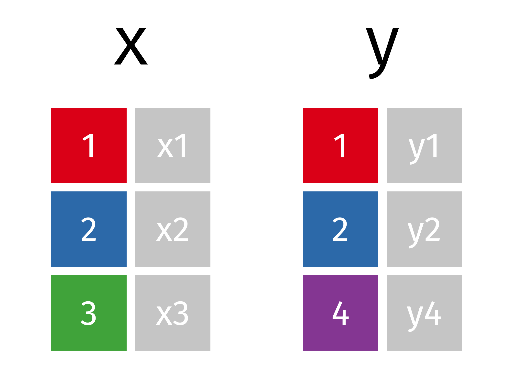
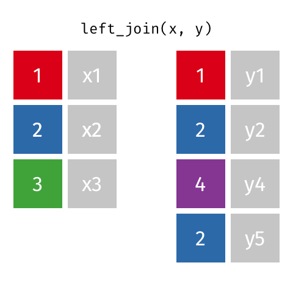
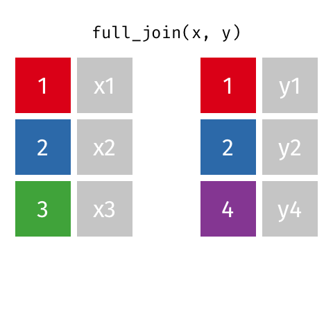
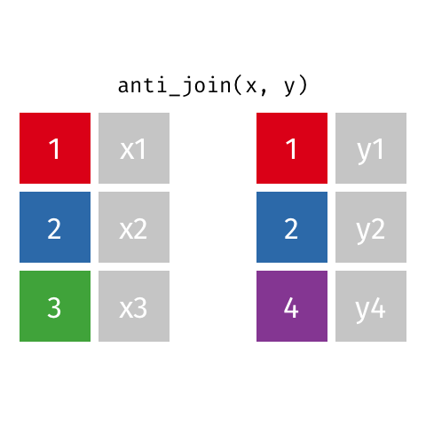

```{r}
#| label: "packages"
#| include: FALSE
library(flipbookr)
library(here)
library(tidyverse)
library(kjhslides)
```


```{r}
#| label: "setup"
#| include: FALSE

kjh_register_tenso()
kjh_set_knitr_opts()
kjh_set_slide_theme()

```


## Load the packages, as always

```{r}
#| label: "07-iterating-on-data-2"
#| message: TRUE
library(here)      # manage file paths
library(socviz)    # data and some useful functions
library(tidyverse) # your friend and mine
library(gapminder) # inescapable

library(DBI) # DBMS interface layer
library(duckdb) # Local database server

```

# "Big" Data

## What we're talking about

Mostly in this case, datasets that are nominally larger than your laptop's memory.

There are other more specific uses, and truly huge data is beyond the scope of the course. But we can look at methods for working with data that's "big" for all practical purposes.

## Databases

When we're working with data in the social sciences the basic case is a single table that we're going to do something with, like run a regression or make a plot.

```{r}
gapminder
```

But the bigger a dataset gets, the more we have to think about whether we really want (or even can have) all of it in memory all the time.

## Databases

In addition, much of what we want to do with a specific dataset will involve actually acting on some relatively small subset of it.

```{r}
gapminder |>
  select(gdpPercap, lifeExp)
```

## Databases

In addition, much of what we want to do with a specific dataset will involve actually acting on some relatively small subset of it.

```{r}
gapminder |>
  filter(continent == "Europe",
         year == 1977)
```

## Databases

In addition, much of what we want to do with a specific dataset will involve
actually acting, at any given moment, on some relatively small subset of it.

```{r}
gapminder |>
  group_by(continent) |>
  summarize(lifeExp = mean(lifeExp),
            pop = mean(pop),
            gdpPercap = mean(gdpPercap))
```


## Databases

Efficiently storing and querying really large quantities of data is the realm of the database and of Structured Query Languages.

As with everything in information technology there is a long and interesting story about various efforts to come up with a good theory of data storage and retrieval, and efficient algorithms for it. If you are interested, watch e.g. [this lecture from a DBMS course](https://www.youtube.com/watch?v=LWS8LEQAUVc&t=755s) from about twelve minutes in.

## Where's the database?

Local or remote?

On disk or in memory?

The important thing from the database admin's point of view is that the data is stored _efficiently_, that we have a means of _querying_ it, and those queries rely on some search-and-retrieval method that's _really fast_.

There's no free lunch. We want storage methods to be efficient and queries to be fast because the datasets are gonna be gigantic, and accessing them will take time.

## Database layouts

A real database is usually not a single giant table. Instead it is more like a
list of tables that are partially connected through key---i.e. columns with
some values---shared between tables. Those keys are indexed and the tables are
stored in a tree-like way that makes searching much faster than just going down
each row and looking for matches.

From a social science perspective, putting things in different tables might be
thought of a matter of logically organizing entities at different _units of
observation_. Querying tables is a matter of assembling  _ad hoc_ tables for
some chosen set of variables and at some specific _unit of analysis_.

(Again, "What is a row in this table?" is our most basic question.)

## Database layouts

::: {.smallcode}

```{r}
gapminder_xtra <- read_csv(here("files", "examples", "gapminder_xtra.csv"))
gapminder_xtra |>
    select(country:lifeExp, country_fr, iso3, area_pct, gm_countries)
```
:::

Get this with `read_csv("https://kjhealy.co/gapminder_xtra.csv")` if you want to
follow along.

In Social Science terms, redundancies are annoying in part because they apply to
different levels or units of observation. From a database point of view, they
are bad because they make errors or anomalies more likely when updating the table, and they
make queries inefficient.

## Database normalization

A hierarchical set of rules and criteria for ensuring the integrity of data stored across multiple tables and for reducing redundancy in data storage.

Tries to eliminate various sources of error --- so-called Insertion, Update, and Deletion anomalies --- particularly ones that will pollute, damage, or corrupt things beyond the specific change.

Redundancy and error are minimized by breaking the database up into a series of
linked  tables. Each table expresses a _relation_ of some kind, and we can
deduce new relations (i.e. new tables) by writing statements in a query language
that returns tables expressing that relation, and containing the records that
satisfy the relation. Hence the term "relational database".

## Normal Forms

*0NF*: No duplicate rows!

*1NF*: Using row order to convey information is not allowed; Mixing data types in the same column is not allowed; Tables without a primary key are not allowed. Primary keys can be defined by more than one column though. No "repeating groups".

*2NF*: Each non-key attribute must depend on the entire primary key

*3NF*: Every non-key attribute should depend wholly and only on the key.

Think of these rules in connection with ideas about "tidy data" that we've
already covered. There are higher Normal Forms too (fourth, fifth) that impose
further criteria based on various edge cases.

::: {.notes}
Good S/O answer: https://stackoverflow.com/questions/23194292/normalization-what-does-repeating-groups-mean
The term "repeating group" originally meant the concept in CODASYL and COBOL
based languages where a single field could contain an array of repeating values
(like a list column in some ways). When E.F.Codd described his First Normal Form
that was what he meant by a repeating group. The concept does not exist in any
modern relational or SQL-based DBMS.

The term "repeating group" has also come to be used informally and imprecisely by database designers to mean a repeating set of columns, meaning a collection of columns containing similar kinds of values in a table. This is different to its original meaning in relation to 1NF. For instance in the case of a table called Families with columns named Parent1, Parent2, Child1, Child2, Child3, ... etc the collection of Child N columns is sometimes referred to as a repeating group and assumed to be in violation of 1NF even though it is not a repeating group in the sense that Codd intended.

This latter sense of a so-called repeating group is not technically a violation of 1NF if each attribute is only single-valued. The attributes themselves do not contain repeating values and therefore there is no violation of 1NF for that reason. Such a design is often considered an anti-pattern however because it constrains the table to a predetermined fixed number of values (maximum N children in a family) and because it forces queries and other business logic to be repeated for each of the columns. In other words it violates the "DRY" principle of design. Because it is generally considered poor design it suits database designers and sometimes even teachers to refer to repeated columns of this kind as a "repeating group" and a violation of the spirit of the First Normal Form.


Separate

1NF : Your table is organized as an unordered set of data, and there are no repeating columns.

2NF: You don't repeat data in one column of your table because of another column. [nb repeating groups]

3NF: Every column in your table relates only to your table's key -- you wouldn't have a column in a table that describes another column in your table which isn't the key.
:::

## Database normalization

```{r}
gapminder_xtra
```

## Database normalization

```{r}
gapminder
```

## Database normalization

```{r}
continent_tbl <- read_tsv(here("files", "examples", "continent_tab.tsv"))
country_tbl <- read_tsv(here("files", "examples", "country_tab.tsv"))
year_tbl <-  read_tsv(here("files", "examples", "year_tab.tsv"))
```

Get these with, e.g., `read_tsv("https://kjhealy.co/continent_tab.tsv")`.

NB: `tsv`, not `csv`! _tab_ not _comma_. (Why?)


## Database normalization

```{r}
continent_tbl
```

## Database normalization
```{r}
country_tbl
```

## Database normalization

```{r}
year_tbl
```

## Table joins

{width=50%}


::: aside
Spiffy Join Animatations courtesy [Garrick Aden-Buie](github.com/gadenbuie/join-animations-with-gganimate.R)
:::

## Left join, [left_join()]{.fg-yellow}


## Left join (contd), [left_join()]{.fg-yellow}



## Inner join, [inner_join()]{.fg-yellow}


## Full join, [full_join()]{.fg-yellow}



## Semi join, [semi_join()]{.fg-yellow}


## Anti join, [anti_join()]{.fg-yellow}



## Joining our gapminder tables

`year_tbl` knows each country only by its `country_id`. Get the names from `country_tbl`:

::: {.smallcode}

```{r}
year_tbl |>
  left_join(country_tbl, by = "country_id") |>
  select(country, year, lifeExp, iso3)
```

:::

## Joining our gapminder tables

Chain a series of joins to rebuild `gapminder_xtra` from its parts:

::: {.smallcode}

```{r}
year_tbl |>
  left_join(country_tbl, by = "country_id") |>
  left_join(continent_tbl, by = "continent_id") |>
  select(country, continent, year, lifeExp, pop, gdpPercap, area_pct)
```

:::

Each table's key links it to the next one: `country_id` gets us from years to countries, and `continent_id` gets us from countries to continents.

## Filtering joins

`country_tbl` has every ISO country, but gapminder only has data for some of them.

::: {.smallcode}

```{r}
# Countries that have some gapminder data
country_tbl |>
  semi_join(year_tbl, by = "country_id")

# Countries that have none
country_tbl |>
  anti_join(year_tbl, by = "country_id") |>
  select(country_id, iso_country, iso3)
```

:::


# Talking to databases

## The main idea

Ultimately, we query databases with SQL. There are several varieties, because there are a variety of database systems and each has their own wrinkles and quirks.

We try to _abstract away_ from some of those quirk by using a DBI (DataBase Interface) layer, which is a generic set of commands for talking to some database. It's analogous to an API.

We also need to use a package for the DBMS we're talking to. It translates DBI instructions into the specific dialect the DBMS speaks.

##  Talking to databases

Some databases are small, and some are far away.

*Client-server* databases are like websites, serving up responses to queries. The database lives on a machine somewhere in the building, or on campus or whatever.

*Cloud* DBMSs are like this, too, except the database lives on a machine in someone else's building.

*In-process* DBMSs live and run on your laptop. We'll use one of these, `duckdb` for examples here.


## Talking to databases

We need to open a _connection_ to a database before talking to it. Conventionally this is called `con`.

Once connected, we ask it questions. Either we use functions or packages designed to translate our R / dplyr syntax into SQL, or we use functions to pass SQL queries on directly.

We try to minimize the amount of time we are actually making the database do a lot of work.

The key thing is that when working with databases our queries are _lazy_ --- they don't actually do anything on the whole database unless its strictly necessary or they're explicitly told to.

# Example: `flights`

## duckdb and DBI

```{r}
# library(DBI)

con <- dbConnect(duckdb::duckdb(), path = ":memory:")
```

Here we open a connection to an in-memory duckdb database. It's empty. We're going to populate it with data from `nycflights`.


## duckdb and DBI

```{r}
copy_to(
  dest = con,
  df = nycflights13::flights,
  name = "flights",
  temporary = FALSE,
  indexes = list(
    c("year", "month", "day"),
    "carrier",
    "tailnum",
    "dest"
    )
  )
```

Remember, keys and indexes are what make databases _fast_.

## Make a lazy tibble from it

This says "go to `con` and get the 'flights' table in it, and pretend it's a tibble called `flights_db`.

```{r}
flights_db <- tbl(con, "flights")

flights_db
```


## Run some dplyr-like queries

```{r}
flights_db |> select(year:day, dep_delay, arr_delay)

```

## Run some dplyr-like queries

```{r}
flights_db |> filter(dep_delay > 240)

```

## Run some dplyr-like queries

```{r}
flights_db |>
  group_by(dest) |>
  summarise(mean_dep_delay = mean(dep_delay))
```


## Lazy, lazy, lazy

```{r}
tailnum_delay_db <-
  flights_db |>
  group_by(tailnum) |>
  summarise(
    mean_dep_delay = mean(dep_delay),
    mean_arr_delay = mean(arr_delay),
    n = n()) |>
  filter(n > 100) |>
  arrange(desc(mean_arr_delay))
```

This doesn't touch the database.

## Lazy, lazy, lazy

Even when we ask to look at it, it just does the absolute minimum required.

```{r}
tailnum_delay_db
```

## When ready, use `collect()`


```{r}
tailnum_delay <-
  tailnum_delay_db |>
  collect()

tailnum_delay
```

Now it exists for realsies.

## Joins

Database systems will have more than one table. We query and join them. The idea is that getting the DBMS to do this will be way faster and more memory-efficient than trying to get `dplyr` to do it.

## Joins

```{r}
## Copy over the "planes" dataset to the same "con" DuckDB connection.
copy_to(
    dest = con,
    df = nycflights13::planes,
    name = "planes",
    temporary = FALSE,
    indexes = "tailnum"
    )

## List tables in our "con" database connection (i.e. now "flights" and "planes")
dbListTables(con)

## Reference from dplyr
planes_db <-  tbl(con, 'planes')
```

See what we did there? It's like `con` the database connection has a list of tables in it.


## Joins

```{r}
# Still not done for realsies!
left_join(
    flights_db,
    planes_db |> rename(year_built = year),
    by = "tailnum" ## Important: Be specific about the joining column
) |>
    select(year, month, day, dep_time, arr_time, carrier, flight, tailnum,
           year_built, type, model)
```

## Finishing up

Close your connection!

```{r}
dbDisconnect(con)
```

# Example: ARCOS Opioids data

## This one is messier

I'm not going to do it on the slides. We'll do it live. We will process a pretty big data file on a machine of modest proportions.
